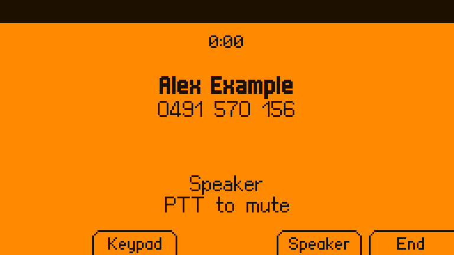
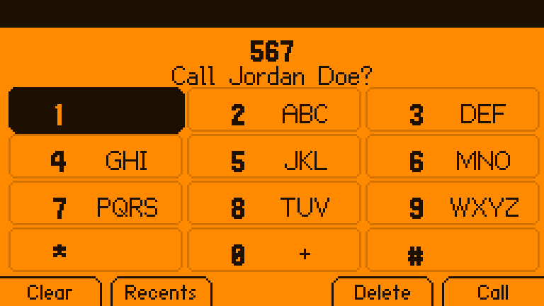
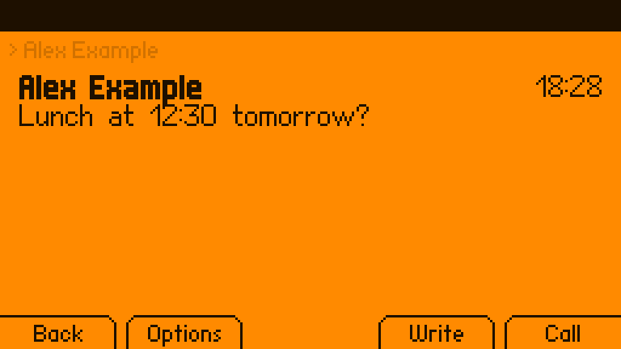
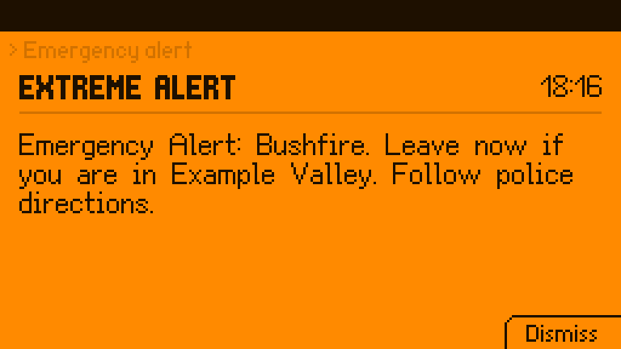

# Dolphone

**Calls and texts for the Flipper One.** Fit a cellular modem in the M.2 slot and
your Flipper One rings: calls, texts, emergency alerts, contacts and a call log, with
Bluetooth headsets, the 3.5 mm jack and speakerphone. On the panel it is a set of
ordinary [FlipCTL](https://github.com/flipperdevices/flipctl-slint) apps driven by the
Flipper's own buttons; in desktop mode it is a proper desktop app; from a shell it is
`phonectl`.

<p align="center">
  
  
</p>
<p align="center">
  
  
  
</p>

> **Unofficial.** Dolphone is not made or endorsed by Flipper Devices.
> **Not for emergencies.** It passes 000/112/911 to the modem, which the network treats as emergency calls, and
> never blocks them, but it is hobby software on a pre-release device: carry a real
> phone.

## What it does

| | |
|---|---|
| **Calls** | Dial, answer, decline, hold, swap and merge (conference), call waiting, keypad tones, mute; speed dial (hold 2–9) and voicemail (hold 1); T9 name matching; the country's own busy and ringback tones; a call log with missed calls |
| **Calls over the internet** | A SIP account (through baresip) for when there is no signal, or always, receiving texts over SIP too; same screens, buttons and headsets; a SIP call and a mobile call can be held and swapped. Emergency calls always go over the mobile network |
| **Texts** | Conversations, multipart texts with a live segment counter, quick replies, delivery reports, resend for a failed text, search, export to Android (SMS Backup & Restore) |
| **Picture messages and group texts** | MMS through mmsd-tng: pictures attached from the panel or the desktop and shown in the desktop app, group conversations as one thread, replies to everyone |
| **Carrier services** | Call forwarding (`**21*n#`, `*#21#`, `##002#`), caller ID (`#31#`), call waiting, and USSD balance codes from the keypad; a check of the modem's own setup for calls (USB audio, VoLTE, the carrier profile) that sets it right with one press |
| **Emergency alerts** | Cell broadcast (national, extreme, severe, Amber, test), full screen over everything, sounding through silent mode |
| **Audio** | Built-in speaker (with echo cancellation), 3.5 mm headsets and speakers, Bluetooth headsets (HFP) and speakers (A2DP), an earpiece where the machine has one; calls follow a headset in and out; music pauses for a call; the LEDs flash for a ringing call if you like |
| **Contacts** | `.vcf` files; copy your phonebook from your current phone over Bluetooth (no account, no sign-in), or import an export from Google or iCloud; names and numbers only |
| **The panel** | FlipCTL apps under Apps > Phone that use every button the way FlipCTL means it: Run answers, Escape declines, PTT mutes (and held, switches the ringer), the touchpad taps the keypad, the motor has a vibration for each kind of news |
| **Desktop mode** | A full desktop app with keyboard shortcuts, notifications with Answer / Decline / Reply, a tray icon, `tel:` and `sms:` links, and Copy for one-time codes |
| **Your laptop** | KDE Connect (GSConnect on GNOME): texts and call alerts on a laptop on the same network, and replies from it, paired on the device |
| **Scripts** | `phonectl` (with `--json`), a D-Bus API, standing grants ("this program may text these numbers, 4 an hour"), rules that run a command when a matching text arrives, an optional local SMS gateway (HTTP), texts when the uplink goes down, and an audit log of what programs asked for |
| **Safety** | Premium numbers and short codes always need a press on the device; outside programs wait for one to dial, text, or change contacts, and cannot read messages, answer, or change settings unless you allow it; rate limits; blocked numbers; silence for unknown callers; a warning when the network forces 2G, and a switch to refuse it; a PIN for Messages; the message store can be encrypted, its key sealed to the machine |
| **The phone's state** | SIM PIN on the keypad; a Today screen of missed calls and unread texts; stays awake for calls and catches up after sleep; follows the modem through resets; records which SIM each text and call went through |

## How it fits together

```
 FlipCTL (unchanged)        Dolphone apps on the panel         dolphone-desktop    phonectl
        │                    Phone · Messages · Settings        (desktop mode)     (scripts)
        │ flipctl open                 │                              │                │
        └──────────────┐               │      D-Bus (session)        │                │
                       ▼               ▼                              ▼                ▼
                  ┌──────────────────────────────────────────────────────────────────────┐
                  │ phoned: calls, texts, alerts, call audio, contacts, Bluetooth, the store │
                  └───────┬───────────────┬────────────────┬──────────────┬─────────────┘
                          │ D-Bus (system)│ PipeWire       │ BlueZ        │ baresip
                     ModemManager      speaker / jack /   headsets,      SIP calls
                          │            Bluetooth / modem  phonebook
                     M.2 modem (RM520N-GL)
```

phoned is the only thing that talks to ModemManager's voice and messaging and the
only thing that routes call audio, so the panel, the desktop and your scripts never
disagree about a call. More in [docs/ARCHITECTURE.md](docs/ARCHITECTURE.md).

## Status

Everything above works against **fake-mm**, a stand-in ModemManager that `mmcli`
itself accepts, and a second baresip playing the far end of SIP calls. The tests:

- **242 end-to-end checks** (`scripts/e2e.sh`): phoned, the fake modem, a fake
  mmsd-tng and phonectl playing through calls, texts, MMS, alerts, SIM PIN and SIM
  codes, an emergency call with the SIM locked, SIP, service codes, the modem's
  setup, grants, rules, contacts, the encrypted store, serial call audio through
  real PipeWire, and what an untrusted script is and is not allowed to do; they
  also pass with every CPU core busy, as a stand-in for a slow device;
- **5 live UI tests** (`scripts/ui-e2e.sh`): the Dialer, Messages, Settings and the
  desktop app (and its tray icon), driven through their real input against a live
  phoned, with a screenshot of each step;
- **10 KDE Connect checks** (`scripts/kdeconnect-e2e.sh`) against the real
  kdeconnectd: pairing, texts both ways, a ringing call;
- **214 unit tests**, including every panel screen rendered and checked against the
  panel's fonts.

Before release it had thirty reviews: ten for features and fit, then twenty more
on security from a same-user program and from the network, Rust robustness,
concurrency, data integrity, packaging, the modem, audio, emergency calling,
telephony standards, numbers abroad, accessibility, the scripting API, the tests
themselves, onboarding, FlipCTL's conventions, licensing, battery use, failure
recovery and privacy. What they found is fixed or written down in
[ROADMAP.md](ROADMAP.md).

The panel apps also run in the real FlipCTL (its browser view, in a VM).
**Dolphone has not yet carried a real call**: that needs the hardware test in
[docs/HARDWARE.md](docs/HARDWARE.md), whose deciding question is whether the
RM520N-GL's USB audio gives Linux two-way call audio.

## Install on the Flipper One

Flipper OS is Debian 13 (arm64):

```sh
sudo apt install ./dolphone_0.1.0_arm64.deb   # built with scripts/package-deb.sh until the first release
dolphone-install-apps                          # as yourself: Apps > Phone on the panel
```

The install asks one question: whether Dolphone may send setup commands to the modem,
which turns on ModemManager's debug mode (yes by default on a Flipper One, where call
audio needs it; `sudo dolphone-modem-access on|off` changes it later, and `port on`
gives Dolphone a spare AT port instead, untested on a real modem). The package
recommends what the optional parts use: mmsd-tng for picture messages and group texts,
baresip for SIP, bluez-obexd for copying contacts from a phone, wl-clipboard or xclip
for Copy, and suggests espeak-ng for spoken caller ID. More in [docs/install.md](docs/install.md).

## Other devices

Dolphone is built for the Flipper One, and its panel apps are FlipCTL's. Underneath,
phoned only needs Linux, ModemManager, PipeWire and BlueZ, so the daemon, `phonectl`
and the desktop app run on other machines with a modem too. What differs between
machines (mixer controls, where the modem's audio is, which front ends fit) is a
**device profile**: one TOML file, picked automatically and shown by
`phonectl device`. These ship:

| Device | Status | What works |
|---|---|---|
| **Flipper One** | expected | everything: the panel apps, desktop mode, the CLI |
| ClockworkPi uConsole (4G extension) | untested | calls (the SIM7600's serial call audio bridged to PipeWire), texts, SIP |
| Raspberry Pi with a USB modem or HAT | untested | texts, SIP calls; mobile calls where the modem offers USB audio |
| PinePhone | untested | calls through its UCM voice-call profile, on the earpiece first; texts, SIP |
| Purism Librem 5 | untested | calls (its modem is a separate sound card, bridged as on the Flipper), on the earpiece first; texts, SIP |
| Laptop | untested | the desktop app, SIP calls, texts and calls where the WWAN modem allows them |
| Anything else | expected | the generic profile: default devices, nothing touched |

Each profile says where its values came from; "untested" means nobody has run
[docs/HARDWARE.md](docs/HARDWARE.md) on one yet. Adding a machine is one file, no
code: [docs/DEVICES.md](docs/DEVICES.md). There is an amd64 package for laptops.

## Try it without a Flipper One

On an Apple Silicon Mac with [OrbStack](https://orbstack.dev):

```sh
scripts/dev-setup.sh                 # a Debian 13 arm64 machine, FlipCTL built, fake modem in
orb -m f1 scripts/run-dev.sh         # build, install, start; open http://f1.orb.local:8899/
orb -m f1 ~/.local/bin/phonectl fake ring 0491570156     # and watch the panel
orb -m f1 ~/.local/bin/phonectl fake sms 0491570156 "hello"
orb -m f1 ~/.local/bin/phonectl fake broadcast 4370 "Test alert"
```

More in [docs/DEVELOPING.md](docs/DEVELOPING.md).

## From a shell

```sh
phonectl send --wait 0491570156 "build finished"   # waits for a press on the device, then for the network
phonectl mms 0491570156 --file photo.jpg "Look"    # a picture message (needs mmsd-tng)
phonectl modem setup                               # is the modem set up for calls? (apply to fix it)
phonectl otp --from 0491570156 --wait 60           # prints the code from the next text (needs a read grant)
phonectl grant 0491570156 4 30                      # ask to text it without asking, 4 an hour, for 30 days
phonectl --json watch                               # every event, one JSON object per line
phonectl contacts import ~/Downloads/contacts.vcf
phonectl device                                     # which device profile, and why
```

`phonectl help` lists the rest. For scripts, it exits 0 when done (or waiting
for the device), 1 when tried and failed, 2 when not allowed, 3 for a bad
argument or something this phone does not do, 4 over a rate limit, and 5 when
phoned is not running. Everything it does is on the D-Bus API, which `busctl`
and `gdbus` reach as well.

## What is not done

- **A real call.** Everything is tested against stand-ins; the hardware test in
  [docs/HARDWARE.md](docs/HARDWARE.md) comes first, and with it the Quectel commands
  that only real firmware can confirm.
- **A large-text mode, fonts beyond Latin and Cyrillic, and news outside Dolphone's
  apps on the panel** (a status-bar badge, a toast): [FlipCTL](https://github.com/flipperdevices/flipctl-slint) has none of
  these. They belong there, for every app, but Dolphone could add them as options
  too. Until then, names the font cannot draw
  fall back to the number.
- **Sending texts to a SIP address**: baresip 1.1.0 cannot; texts over SIP are
  received, and replies go over the mobile network.
- **RCS**: there is no route to it from Linux.

[ROADMAP.md](ROADMAP.md) has the details.

## Docs

- [Install](docs/install.md)
- [Buttons](docs/BUTTONS.md): every key on every screen
- [Rules on incoming texts](docs/RULES.md): run a command when a matching text arrives
- [Architecture](docs/ARCHITECTURE.md): the pieces and why they are split that way
- [Audio](docs/AUDIO.md): routes, echo cancellation, Bluetooth, the jack
- [Devices](docs/DEVICES.md): device profiles, and adding one
- [Hardware bring-up](docs/HARDWARE.md): the go/no-go test with a real modem
- [Developing](docs/DEVELOPING.md): the dev machine, tests, bundles, packages
- [Security](SECURITY.md): the threat model and what to report
- [Contributing](CONTRIBUTING.md)

## License

Source: MIT. The panel apps and the desktop app link Slint (the panel apps through
flipctl-app) under GPL-3.0-only, so **those binaries are GPL-3.0-only**; each
release carries the full corresponding source, and the Debian package says where
it is in `/usr/share/doc/dolphone/copyright`. phoned, phonectl and the gateway are
MIT, with their dependencies' notices in `THIRD-PARTY-LICENSES.md` (SQLCipher's
among them). The panel fonts are CC BY-SA 3.0, Unlicense and MIT, and the AppImage
runtime at the head of each bundle has its own notices; see each bundle's
`NOTICE.md`.
