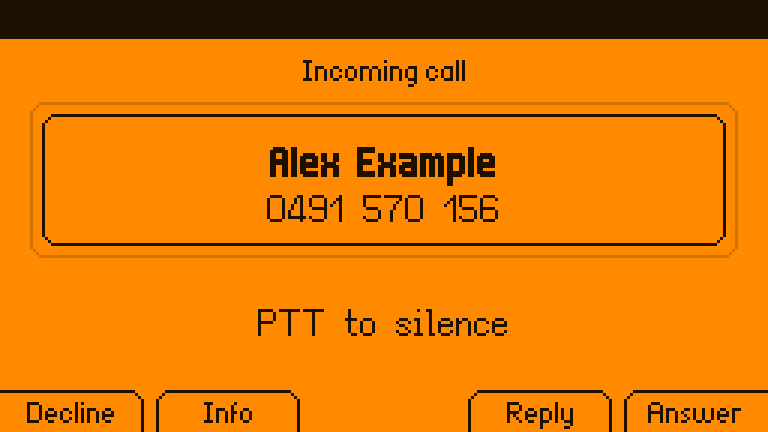
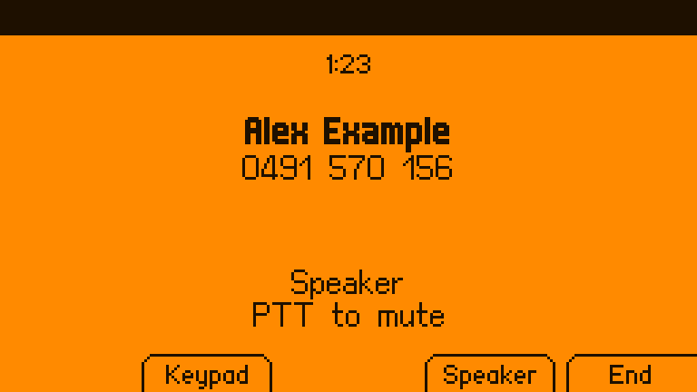
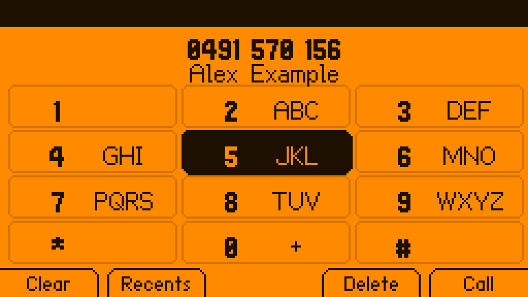
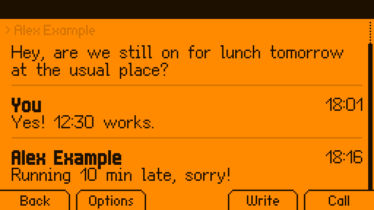
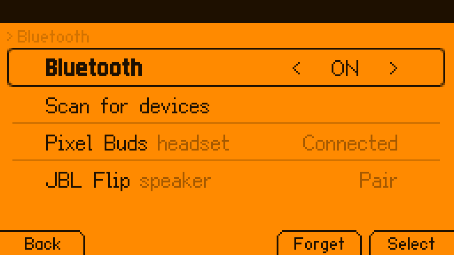

# Dolphone

**Calls and texts for the Flipper One.** Fit a cellular modem in the M.2 slot and
your Flipper One rings: VoLTE calls, texts, contacts and a call log, with Bluetooth
headsets, the 3.5 mm jack and speakerphone. On the panel it is a set of ordinary
[FlipCTL](https://github.com/flipperdevices/flipctl-slint) apps driven by the
Flipper's own buttons; in desktop mode it is a proper desktop app.

<p align="center">
  
  
</p>
<p align="center">
  
  
  
</p>

> **Unofficial.** Dolphone is not made or endorsed by Flipper Devices.
> **Not for emergencies.** It passes 000/112/911 to the modem as emergency calls and
> never blocks them, but it is hobby software on a pre-release device: carry a real
> phone.

## What it does

| | |
|---|---|
| **Calls** | Dial, answer, decline, hold and swap, call waiting, keypad tones, mute, a call log with missed calls |
| **Texts** | Conversations, multipart texts with a live segment counter, quick replies to a ringing call |
| **Audio** | Built-in speaker (with echo cancellation), 3.5 mm headsets and speakers, Bluetooth headsets (HFP) and speakers (A2DP); calls follow a headset in and out |
| **Contacts** | `.vcf` files you copy in from your phone; numbers show as names everywhere |
| **The panel** | FlipCTL apps under Apps > Phone that use every button the way FlipCTL means it: Run answers, Escape declines, PTT mutes, the touchpad scrolls and types, the motor rings |
| **Desktop mode** | A full desktop app, notifications with Answer / Decline / Reply, and `tel:` and `sms:` links |
| **Scripts** | `phonectl send 0491570156 "build finished"`, a D-Bus API, and a confirmation on the device for anything a script asks for |
| **Safety** | Premium numbers and short codes always need a press on the device; outside programs wait for one to text or dial, and cannot read messages, answer, or change settings unless you grant it; rate limits; blocked numbers |

## How it fits together

```
 FlipCTL (unchanged)        Dolphone apps on the panel         dolphone-desktop
        │                    Phone · Messages · Settings        (desktop mode)
        │ flipctl open                 │                              │
        └──────────────┐               │      D-Bus (session)        │
                       ▼               ▼                              ▼
                  ┌──────────────────────────────────────────────────────┐
                  │ phoned: calls, texts, call audio, Bluetooth, the store │
                  └───────┬───────────────┬────────────────┬─────────────┘
                          │ D-Bus (system)│ PipeWire       │ BlueZ
                     ModemManager      speaker / jack /   headsets
                          │            Bluetooth / modem
                     M.2 modem (RM520N-GL)
```

phoned is the only thing that talks to ModemManager's voice and messaging and the
only thing that routes call audio, so the panel, the desktop and your scripts never
disagree about a call. More in [docs/ARCHITECTURE.md](docs/ARCHITECTURE.md).

## Status

Everything above works against **fake-mm**, a stand-in ModemManager that `mmcli`
itself accepts, and the panel apps run in the real FlipCTL (its browser view, in a
VM). Call audio bridging has been exercised in PipeWire with stand-in modem nodes.
**It has not yet carried a real call**: that needs the hardware test in
[docs/HARDWARE.md](docs/HARDWARE.md), whose deciding question is whether the
RM520N-GL's USB audio gives Linux two-way call audio.

## Install (Flipper OS or any arm64 Debian 13)

```sh
sudo apt install ./dolphone_0.1.0_arm64.deb   # from the releases page
dolphone-install-apps                          # as yourself: Apps > Phone on the panel
```

Contacts: put `.vcf` files in `~/.local/share/dolphone/contacts/`. Board-specific
audio (mixer controls for the speaker and jack) goes in `~/.config/dolphone/audio.json`;
see `/usr/share/doc/dolphone/audio.example.json`.

## Try it without a Flipper One

On an Apple Silicon Mac with [OrbStack](https://orbstack.dev):

```sh
scripts/dev-setup.sh                 # a Debian 13 arm64 machine, FlipCTL built, fake modem in
orb -m f1 scripts/run-dev.sh         # build, install, start; open http://f1.orb.local:8899/
orb -m f1 phonectl fake ring 0491570156          # and watch the panel
orb -m f1 phonectl fake sms 0491570156 "hello"
```

More in [docs/DEVELOPING.md](docs/DEVELOPING.md).

## What's missing

Plenty, and it is written down: [ROADMAP.md](ROADMAP.md) collects ten reviews of what
people expect from a phone on a machine like this (suspend and wake, MMS, emergency
alerts, voicemail, speed dial, smart dialing, KDE Connect, spoken caller ID...).

## Docs

- [Architecture](docs/ARCHITECTURE.md): the pieces and why they are split that way
- [Buttons](docs/BUTTONS.md): every key on every screen
- [Hardware bring-up](docs/HARDWARE.md): the go/no-go test with a real modem
- [Audio](docs/AUDIO.md): routes, echo cancellation, Bluetooth, the jack
- [Developing](docs/DEVELOPING.md): the dev machine, tests, bundles, packages
- [Security](SECURITY.md): the threat model and what to report
- [Contributing](CONTRIBUTING.md)

## License

Source: MIT. The panel apps link Slint through flipctl-app under GPL-3.0-only, so
their **binaries are GPL-3.0-only**; each release carries the full corresponding
source. The panel fonts are CC BY-SA 3.0, Unlicense and MIT; see each bundle's
`NOTICE.md` and `THIRD-PARTY-LICENSES.md`.
