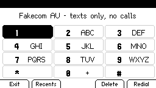

# Choosing a modem

Dolphone works with any modem ModemManager supports, but what the phone can do
depends on the modem, and then on the SIM in it. Nothing here has been tried on real
hardware yet; every claim below comes from the source linked beside it.

## Three different limits

These get confused, and they fail in different ways:

| | What it means | What Dolphone does |
|---|---|---|
| **A data-only modem** | The modem has no voice support at all (ModemManager shows no Voice interface). Most M.2 5G modules are like this, the RM520N-GL included. Some still send and receive texts. | It knows straight away. The Dialer says "texts only, no calls"; dialling says "this modem cannot make calls"; 000 says to call from another phone; the modem's setup leaves call audio and VoLTE alone. Texts, picture messages and calls over SIP still work. |
| **A data-only SIM** (or plan) | The modem could call, but your plan has no calls or texts. | It cannot tell until the network refuses: a call fails when dialled, a text fails when sent. Check the plan, not the modem. |
| **No VoLTE on your network** | The modem and the plan can call, but the carrier will not carry this modem's VoLTE calls. In Australia, where 3G is gone, that means no mobile calls at all, and the ACMA rules have carriers block a device that can call but cannot reach 000 over VoLTE ([ACMA](https://www.acma.gov.au/ensuring-mobiles-can-reach-000-after-3g-shutdown)). | Calls fail to connect. Ask the carrier before buying. |

**Calls over the internet (SIP)** need none of this: a SIP account works over any
data link, a data-only modem, a data-only SIM or Wi-Fi. SIP cannot reach emergency
services; only a modem that can call does.

## Which modem for what

For a whole phone (calls, texts and data) in Australia, a modem has to do VoLTE, be
accepted by the carrier, and get its call audio to Linux. Telstra publishes the
modules it has certified, and which of them it certified for VoLTE ([Telstra's
list](https://www.telstra.com.au/content/dam/shared-component-assets/tecom/iot/capabilities/certified-devices/telstra-m2m-certified-devices-modules.pdf),
28 October 2026); Optus and Vodafone publish no such list.

Telstra also asks for these bands at least: 4G B3, B7 and B28; 5G n7, n26 and n78
(same list). In community testing, modems on their generic profile get VoLTE on
Optus and Vodafone more often than on Telstra, where a modem without a Telstra
profile is reported refused ([Consumer Rights Wiki](https://consumerrights.wiki/w/Voice_over_LTE));
Telstra's certified firmware is the way round that, so ask the module's vendor for it.

These fit the Flipper One's slot with no adapter (Key B; 2242, 3042 or 3052, and 2230
with an extender; single-sided;
[Flipper's specs](https://docs.flipper.net/one/general/tech-specs)):

| You want | Buy | Why, and the catch |
|---|---|---|
| **Texts and data, no mobile calls** | Quectel **RM520N-GL** (5G, M.2 3052) | Quectel's staff say it is "data-only" and will not get voice ([forum](https://forums.quectel.com/t/quectel-rm520n-gl-and-volte/32316), [forum](https://forums.quectel.com/t/voice-call-with-the-rm520n-gl/34404)); Telstra lists it without VoLTE. A user reports texts work on it (same thread; not confirmed by Quectel). Add a SIP account for calls. |
| **Calls, with nothing asked of the Flipper but USB** | SIMCom **SIM7600G-H-M2** (4G, M.2 3042) | It has B3, B7 and B28 ([Core Electronics](https://core-electronics.com.au/sim7600g-h-m2-4g-hat-for-raspberry-pi-lte-cat4-high-speed-4g3g2g-gnss-global-band-1.html)). Its call audio comes over USB as raw PCM on a serial port, which Dolphone bridges to PipeWire (the uConsole profile does this) ([SIMCom USB audio note](https://files.waveshare.com/upload/8/8e/SIM7100_SIM7500_SIM7600_Series_USB_AUDIO_Application_Note_V1.03.pdf), [Waveshare](https://waveshare.com/wiki/SIM7600G-H-M.2)). Telstra certified the SIM7600G-H for VoLTE, as a chip and as a mini PCIe card; the M.2 card is not named, so ask SIMCom for the Telstra-certified firmware. Nobody has published an Australian VoLTE call on it; one Librem 5 owner found it would not call out of the box ([Purism forum](https://forums.puri.sm/t/simcom-sim7600g-h-alternative-modem-for-l5-tested/17534)), and a ModemManager bug report says its in-call audio sometimes fails to set up ([issue 797](https://gitlab.freedesktop.org/mobile-broadband/ModemManager/-/issues/797)). |
| **Calls, certified as an M.2 card** | Quectel **EM12-G** (4G Cat 12, M.2 3042), its voice ("Telematics") version | Telstra certified it for VoLTE by name. But its call audio is PCM on M.2 pins 20, 22, 24 and 28 at 1.8 V, not USB (Quectel lists voice over USB as not yet supported) ([hardware design](https://www.quectel.com/content/uploads/2024/02/Quectel_EM12-G_Hardware_Design_V1.3-2.pdf)). Those are the pins the Flipper One's pinout calls GPIO_5 to GPIO_8, and its slot lists "Serial Audio" ([pinout](https://docs.flipper.net/one/hardware/m2-port)); whether they reach the Flipper's audio interface is not published. Buy it only once Flipper says they do. |
| **5G and calls** | Fibocom **FM160-EAU** (M.2 3052) | Telstra certified it for VoLTE; Fibocom lists VoLTE and VoNR. Its call audio is I2S/PCM on the slot's pins, so the same question as the EM12-G; its bands include B28, n28 and n78 but not Telstra's n26 ([4G LTE Mall](https://www.4gltemall.com/fibocom-fm160-eau.html), [M2M Germany](https://www.m2mgermany.de/shop/produkt/fm160-eau-01-00-5g-m.2-modul-usb-version)). No M.2 5G module documented to put call audio on USB was found. |

With an mPCIe adapter there is also the Quectel **EG25-G**, the PinePhone's modem: a
user reports its USB sound card works after a firmware update
([forum](https://forums.quectel.com/t/eg25-and-uac-for-audio/31663)), and VoLTE is
reported working on ALDI Mobile and Amaysim
([forum](https://forums.quectel.com/t/eg25-g-firmware-request-volte-not-registering-on-australian-carriers/56633),
[Pine64 forum](https://forum.pine64.org/showthread.php?tid=12560)). Telstra certified
the EG25-GL, not the EG25-G. Nobody has tried an adapter in a Flipper One.

**Unconfirmed**: the Quectel EM060K lists voice as optional and one owner reports
VoLTE registering ([Purism forum](https://forums.puri.sm/t/em060k-discussion/23551)),
but Telstra certifies the EM060K-GL and EM060K-EA without VoLTE, and an
EM061K-GL owner found its call commands unsupported
([forum](https://forums.quectel.com/t/em061k-gl-calls-not-available/50510)). On the
EC25-E and EM05-E, VoLTE call audio is reported not to reach the USB sound card on
current firmware ([forum](https://forums.quectel.com/t/ec25-e-em05-e-volte-audio-not-flowing-over-uac-0-bytes-during-calls-firmware-request/58506)).

**Not for calls**, by their makers' or certifiers' accounts: Quectel EM05-G
([forum](https://forums.quectel.com/t/can-the-em05-g-support-volte-calls/53006)),
Sierra EM9191 ([forum](https://forum.sierrawireless.com/t/volte-support-on-em-series/22377)),
Fibocom FM350-GL ([T-Mobile](https://www.t-mobile.com/business/solutions/iot/device-certification/fibocom-fm350-gl)),
Telit FN990 ([NTT](https://www.ntt.com/business/iot/product/m263.html)), SIMCom
SIM8200EA-M2 ([Waveshare](https://www.waveshare.com/wiki/SIM8200EA-M2_5G_HAT)). The
RM500Q and RM502Q register VoLTE for some but calls fail
([forum](https://forums.quectel.com/t/voice-over-usb-volte-rm502q-gl/27890)).

A modem with its call audio on the slot's pins would also need the Flipper One
profile changed: it sends the RM520N-GL's `AT+QPCMV=1,2`, which moves Quectel call
audio to USB, and it would need the codec's voice path instead of a bridge, as the
PinePhone's profile has.

If you try one, run [the hardware test](HARDWARE.md) and say what passed: it is how a
row here goes from "reported" to "tested".
